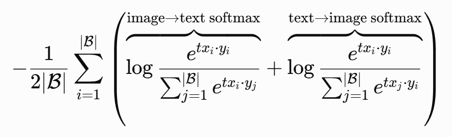
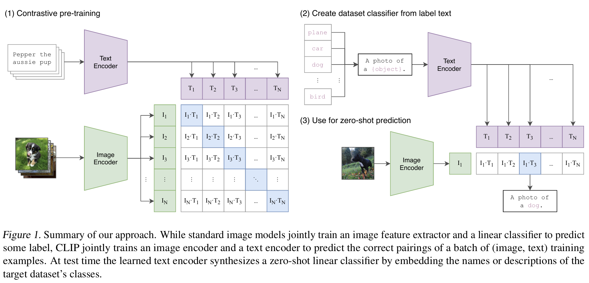

> **一句话总结：**OpenAI提出的图文对的对比学习，用于视觉语义对齐，把batch内图文对相似度的softmax作为损失。

流程如下：

1. 输入图片->图像编码器（vision transformer）->图片特征向量
2. 输入文字->文本编码器（text ）->文本特征向量
3. 对两个特征进行线性投射，得到相同维度的特征，并进行L2归一化
4. 计算两个特征向量的相似度（夹角余弦）
5. 对n个类别进行softmax，根据原始匹配关系正样本对和负样本对，并最大化正样本对的权重。（image-to-text 和 text-to-image 各做一次 softmax）

应用：

1. 图文匹配：把训练好的 CLIP 用于其他任务，例如零样本分类。
2. 跨模态映射：通过图文对比学习，图像编码器学会了编码与文本语义相关的视觉特征。可复用 CLIP 预训练的图像编码器 + 可训练 Projector，将图像投影到 LLM 的语言空间，构建 VLM。

